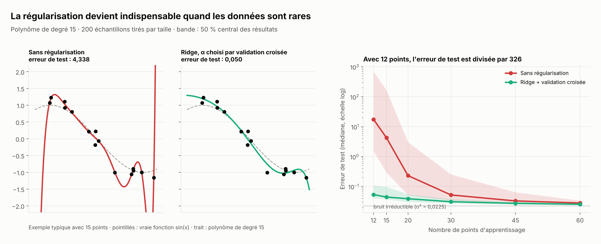
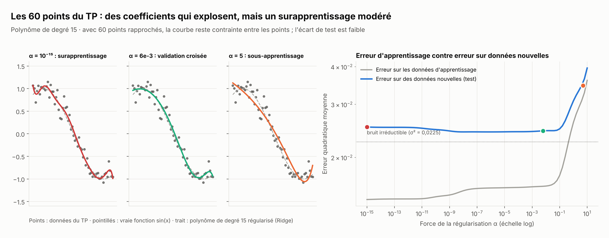
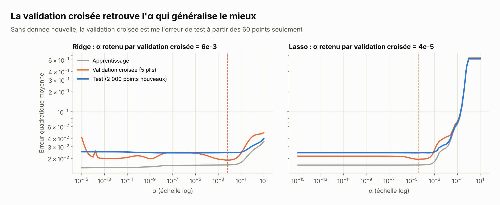
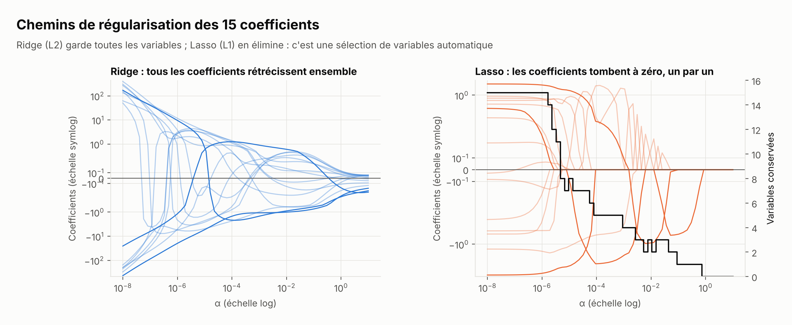
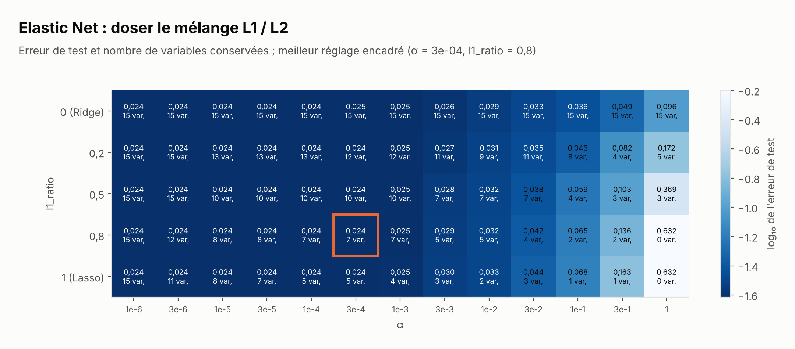
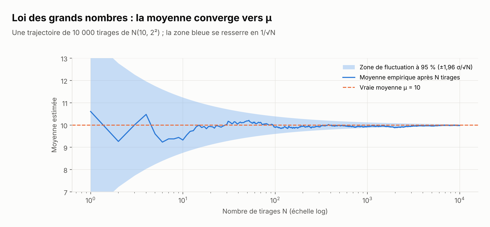
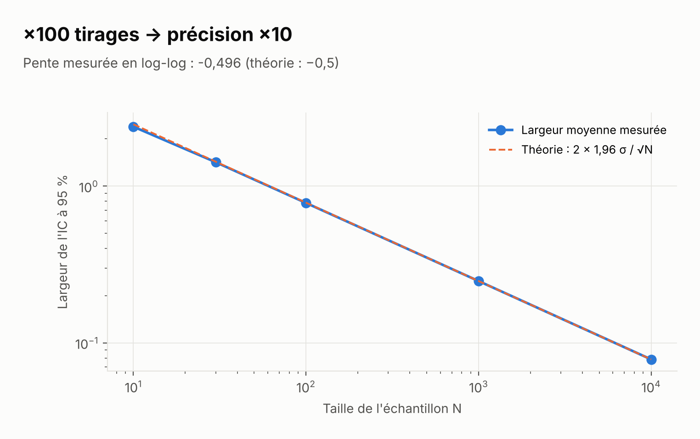
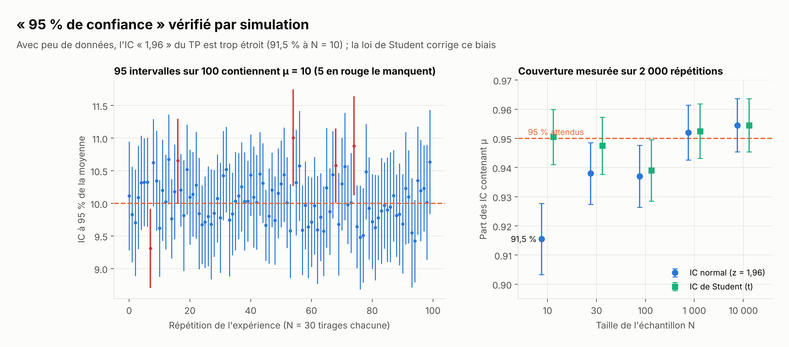

# 📉 Régularisation et Monte-Carlo : quand faire confiance à un modèle ?



[](https://github.com/madjiguenedotesene/regularisation-monte-carlo/actions/workflows/ci.yml)


Deux questions au cœur du machine learning, traitées par l'expérience :

1. **Régularisation** : comment empêcher un modèle trop flexible d'apprendre le bruit ? (Ridge, Lasso, Elastic Net)
2. **Monte-Carlo** : quelle confiance accorder à une estimation ? (loi des grands nombres, intervalles de confiance)

Projet du module d'apprentissage, Master Data Science & Cybersécurité, Université Paris 8 (2025-2026), réécrit et enrichi : chaque affirmation du rapport est ici **vérifiée par simulation**.

## 📊 Résultats clés

| Question | Réponse mesurée |
|---|---|
| La régularisation améliore-t-elle les prévisions ? | **Ça dépend de la quantité de données.** Avec 12 points, l'erreur de test est divisée par **326** ; avec les 60 points du TP, le gain n'est que de 3 % (0,0252 → 0,0245). |
| Comment choisir α sans données de test ? | La **validation croisée** retrouve l'α qui généralise le mieux (Ridge : α ≈ 6·10⁻³). |
| Ridge ou Lasso ? | Erreur de test équivalente (0,0245 contre 0,0243), mais le **Lasso ne garde que 7 variables sur 15**. |
| Meilleur Elastic Net | α = 3·10⁻⁴, l1_ratio = 0,8 : erreur de test 0,0243 avec 7 variables. |
| Un IC à 95 % contient-il la vraie valeur 95 fois sur 100 ? | **Oui à partir de N ≈ 1 000** (95,2 %). À N = 10, la formule « 1,96 » du TP ne couvre que **91,5 %** ; la loi de Student rétablit **95,1 %**. |
| La précision suit-elle 1/√N ? | Pente mesurée en log-log : **−0,496** (théorie −0,5) : 100 fois plus de tirages → IC 10 fois plus étroit. |

## 1️⃣ Régularisation

L'expérience du TP : 60 points d'une sinusoïde bruitée, ajustés par un **polynôme de degré 15**. Sans contrainte, les coefficients explosent (jusqu'à 48 462) ; la régularisation les ramène à l'ordre de l'unité.

**Ce que le TP ne mesurait pas.** Le rapport comparait l'erreur sur les données d'apprentissage. Or celle-ci baisse toujours quand on régularise moins : elle ne peut pas révéler le surapprentissage. Ce dépôt mesure l'erreur sur **2 000 points nouveaux** et par **validation croisée**. Constat honnête : avec 60 points rapprochés, le polynôme reste contraint entre les points et le surapprentissage est modéré. Il devient spectaculaire quand les données sont rares (image de couverture).

| Le TP revisité | La validation croisée choisit α |
|---|---|
|  |  |

| Chemins de régularisation : Ridge rétrécit, Lasso sélectionne | Elastic Net : mélange L1 / L2 |
|---|---|
|  |  |

## 2️⃣ Monte-Carlo et intervalles de confiance

Estimation de la moyenne d'une loi N(10, 2²). Avec 10 000 tirages : moyenne 9,980, IC à 95 % [9,940 ; 10,019], qui contient bien μ = 10.

| Loi des grands nombres | Largeur de l'IC en 1/√N |
|---|---|
|  |  |



Le rapport affirmait que « l'IC contiendrait la vraie moyenne dans 95 cas sur 100 ». La simulation le confirme pour les grands échantillons, mais montre aussi la limite de la formule z = 1,96 sur les petits : c'est la loi de Student qu'il faut utiliser quand σ est estimé sur peu de données.

## 🚀 Reproduire

```bash
git clone https://github.com/madjiguenedotesene/regularisation-monte-carlo.git
cd regularisation-monte-carlo
pip install -r requirements.txt
python run_all.py      # ~1 min : figures dans docs/img, résultats dans results/
pytest -q              # 6 tests des propriétés démontrées
```

Les données du TP sont reproduites à l'identique (même graine) : le test `test_donnees_identiques_au_tp` retrouve le RSS de 0,9537 du rapport.

## 📁 Structure

```
├── run_all.py               # pipeline complet
├── src/
│   ├── regularisation.py    # Ridge, Lasso, Elastic Net, validation croisée, effet de la taille d'échantillon
│   ├── monte_carlo.py       # convergence, couverture des IC (z et Student), largeur en 1/√N
│   └── style.py             # charte graphique
├── tests/                   # tests pytest
├── results/                 # résultats chiffrés (CSV, JSON)
└── docs/img/                # figures
```

## 🧠 Compétences démontrées

Biais-variance et surapprentissage · régularisation L1 / L2 · validation croisée et choix d'hyperparamètres · simulation de Monte-Carlo · intervalles de confiance et couverture · tests automatisés (pytest) · visualisation

## 👤 Auteure

**Madjiguene SENE** · encadrement : M. Zezeber (Université Paris 8)

[LinkedIn](https://www.linkedin.com/in/madjiguene-dote-sene/) · [GitHub](https://github.com/madjiguenedotesene)
